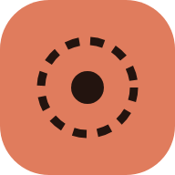
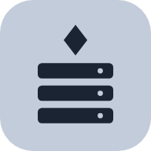

  

<h1 align="center">Pharos</h1>

  <i>Φάρος, lighthouse.</i> Tools that look things up and show you the evidence.

  
  
  

  <a href="https://github.com/oikos-suite">Oikos, the sister suite</a> ·
  <a href="https://github.com/Kolbxyz">Kolb</a>

---

Pharos is a suite of tools that investigate something and report back with their sources. A photo's location, a broken server, a website's problems, a figure in a history lesson: each answer comes with the evidence that supports it, so you can check it yourself.

Chizu and Gaius run on Claude, through your own Claude Code login or API key. None of the tools asks you to just trust the answer.

## Investigate

| | Tool | What it does | Runs on |
|:-:|---|---|---|
|  | **[Chizu 地図](https://github.com/pharos-suite/Chizu)** | Finds where a photo was taken, narrowing from a country down to the spot, on a live map | Web + Claude |
|  | **Gaius** | Watches your Proxmox cluster and Linux machines, works out why something broke and proposes the fix | Your server + Claude Code (not public yet) |
|  | **Prospect** | Finds local businesses and audits their websites for problems it can prove | Your server (not public yet) |

## Explain

| | Tool | What it does | Runs on |
|:-:|---|---|---|
|  | **[Kratos](https://github.com/pharos-suite/Kratos)** | Lessons in French on power, institutions, the economy and war, with every figure linked to its source | Web + Android |
|  | **[PEA Tools](https://github.com/pharos-suite/pea-tools)** | DCA simulator and ETF comparator for the French PEA, with the legal references | Web |

## Shared rules

- **Show the evidence.** Every claim links to a source, a measurement or the raw data behind it.
- **Self-hosted.** Your data stays on your machine or in your browser.
- **No tracking.** No accounts unless the tool needs one, and no analytics.

---

  Made in France · <a href="https://github.com/oikos-suite">See also: Oikos</a>

